<h1 align="center">🔬 <strong>ResearchRelay AI</strong></h1>


<h3 align="center">Transforming Research Ideas into Evidence Grounded Insights</h3>

<p align="center">
  An intelligent multi agent research assistant designed to refine research questions, discover relevant sources, synthesize findings, examine factual claims, and organize academic research materials in one unified workflow.
</p>

<p align="center">
  
  
  
  
  
  
</p>

<p align="center">
  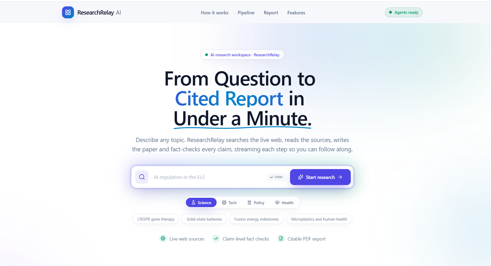
</p>


---

## About the Project

**ResearchRelay AI** is a multi agent research assistant that explores how specialized AI agents can collaborate to make research preparation more structured, traceable, and useful.

Research involves much more than generating text. It requires understanding a problem, discovering relevant information, examining sources, comparing findings, identifying evidence gaps, and organizing conclusions into a meaningful document.

ResearchRelay AI brings these activities into a coordinated workflow powered by a FastAPI backend, a React interface, language models, and web search tools.

Instead of relying on one general purpose AI response, the system separates research into specialized responsibilities. Each agent contributes to a larger process, from refining the initial research idea to preparing a structured research report and academic planning materials.

The project focuses on a fundamental challenge in AI assisted research:

**How can we move beyond fast text generation toward a more structured, evidence aware, and critically reviewed research process?**

Our approach combines multi agent orchestration, source grounded generation, claim verification, cross source comparison, and academic planning to help users move from an initial idea toward a more informed research direction.

## The Problem We Want to Solve

<p align="center">
  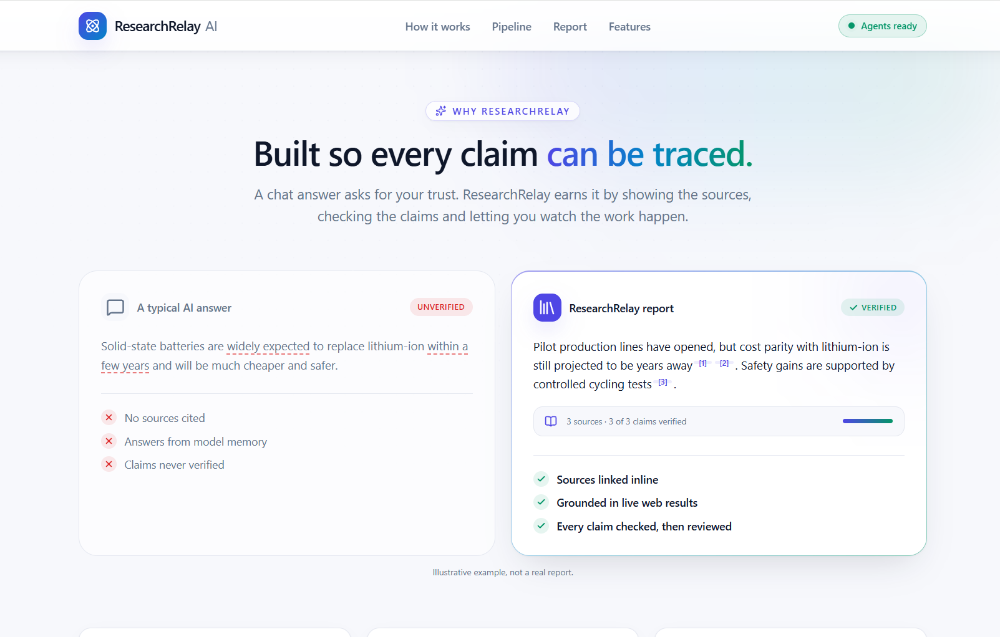
</p>

Research is increasingly important in artificial intelligence, data science, engineering, healthcare, education, and scientific innovation. However, the early stages of research can be fragmented, repetitive, and difficult to organize.

### Unclear research direction

A broad or poorly defined topic often produces irrelevant search results and makes it difficult to identify meaningful research questions.

### Information overload

Researchers must navigate large amounts of online information to find useful studies, extract findings, and determine which sources deserve closer examination.

### Fragmented research activities

Searching, reading, comparing, writing, reviewing, and organizing references commonly happen across separate tools and documents.

### Unreliable AI generated information

Language models can generate convincing statements, statistics, and references that are incomplete, inaccurate, or unsupported by the available evidence.

### Weak evidence traceability

A generated report may include citations without clearly demonstrating how the cited source supports the corresponding claim.

### Time consuming academic preparation

Developing research titles, abstracts, keywords, objectives, methodology, and references requires additional effort before a research proposal or paper can be developed.

These challenges demonstrate why an effective research assistant should do more than produce a well written answer. It should help organize the process, preserve source context, expose uncertainty, and support critical examination of the generated material.

## Our Solution

<p align="center">
  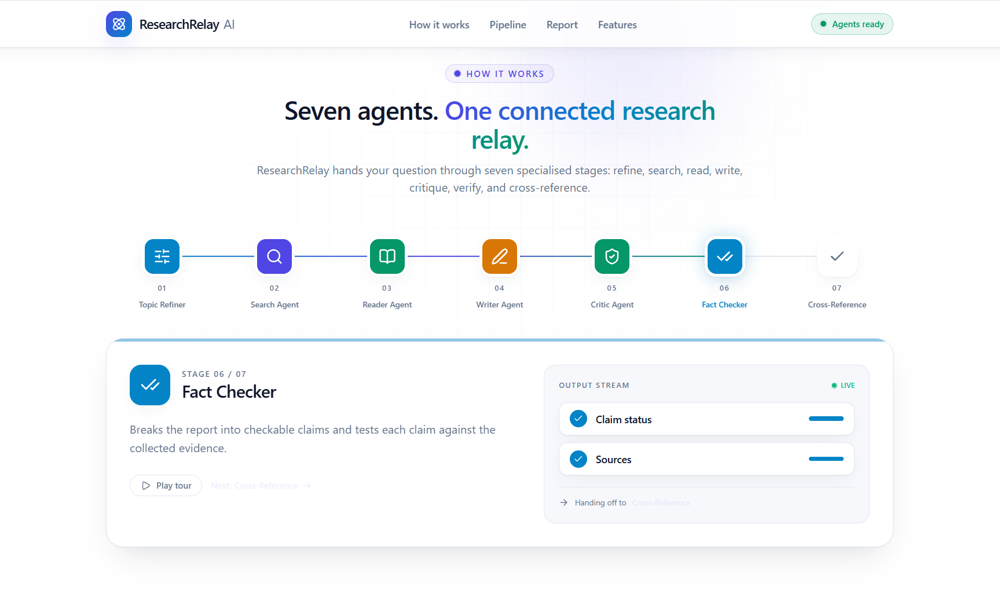
</p>

ResearchRelay AI addresses these challenges through a coordinated workflow of seven specialized AI agents.

The system begins with the user's original research idea, refines its scope, searches for relevant sources, extracts useful evidence, and generates a structured report. Dedicated review stages then examine the report, check claims against available evidence, compare findings across sources, and prepare academic research components.

The result is intended to be more than a standalone AI generated summary. It is a structured research preparation workflow in which source discovery, synthesis, critique, and verification have distinct responsibilities.

### What makes our approach different?

* **Specialized collaboration:** Research responsibilities are separated across seven agents instead of being assigned to a single general purpose generation step.

* **Evidence aware generation:** Source metadata and extracted passages can be carried through the workflow to support claim checking and reference traceability.

* **Independent review stages:** The generated report is examined by dedicated critique and verification stages rather than being treated as automatically correct.

* **Cross source reasoning:** Comparing findings can help reveal disagreements, incomplete evidence, and duplicated information.

* **Academic planning support:** Research ideas can be organized into candidate titles, abstracts, keywords, objectives, methodology, and references.

* **Human centered research:** The system is designed to assist researchers, not replace their judgment, source verification, or responsibility for academic work.

Our goal is to explore a more disciplined approach to AI assisted research by combining generation with evidence inspection and structured review.

## Novelty and Research Contribution

ResearchRelay AI explores the design of a multi stage research assistant that connects topic understanding, source discovery, evidence extraction, report synthesis, critique, claim verification, and academic planning in one workflow.

Its central contribution is the **integration of research generation with explicit evidence review and academic structuring**.

The project emphasizes the following design ideas.

### 1. Research before generation

The process begins by refining the research topic and identifying focused search queries. This encourages the system to gather relevant information before drafting conclusions.

### 2. Evidence linked research synthesis

The workflow is designed to preserve source identity and extracted evidence so that important claims can be checked against the information actually retrieved.

### 3. Separate critique and verification responsibilities

Reviewing writing quality and verifying factual support are different tasks. The system assigns them separate responsibilities to encourage more meaningful evaluation.

### 4. Cross source consistency checking

Comparing evidence from multiple sources can expose conflicting findings, incomplete context, and possible overreliance on a single source.

### 5. Integrated academic preparation

The final research stage organizes the findings into useful academic planning materials, helping users progress from topic exploration toward a preliminary research proposal.

### 6. Transparent uncertainty

When the available evidence does not support a claim or a reference cannot be verified, the intended behavior is to flag the gap rather than invent missing information.

These ideas describe the project's design contribution, not a claim that the architecture is the first of its kind. Establishing scientific novelty would require a systematic comparison with existing research agents and published systems.

## The Seven AI Agents

Each agent has a distinct role within the research workflow.

### 01. Research Topic Refiner and Search Strategist

**Purpose:** Understand the user's intent and establish a focused research direction.

Responsibilities:

* Refine informal or broad research topics while preserving their original meaning.
* Identify important concepts, research scope, and potential research questions.
* Generate relevant keywords and targeted search queries.
* Prepare a structured research plan for source discovery.

**Value:** Improves the clarity and direction of the investigation before external information is collected.

### 02. Research Search and Source Discovery Agent

**Purpose:** Discover relevant online information.

Responsibilities:

* Use the existing Tavily search integration.
* Retrieve potentially relevant webpages and publications.
* Collect available source titles, URLs, dates, and publication metadata.
* Deduplicate results and handle unavailable sources.
* Prioritize relevant and credible sources where their quality can be assessed.

**Value:** Establishes the initial evidence base for the subsequent research stages.

### 03. Research Reader and Evidence Extraction Agent

**Purpose:** Extract useful information from retrieved sources.

Responsibilities:

* Read accessible webpages using the existing content extraction tools.
* Identify key findings, methods, limitations, and supporting passages.
* Retain the source associated with each extracted finding.
* Distinguish retrieved information from generated interpretation.
* Handle inaccessible or incomplete pages gracefully.

**Value:** Converts unstructured source material into information that can be reviewed and reused by downstream agents.

### 04. Research Report Writer Agent

**Purpose:** Synthesize collected evidence into a coherent report.

Responsibilities:

* Develop the research introduction and background.
* Organize relevant findings into structured sections.
* Summarize approaches and observations from the available evidence.
* Generate a discussion and conclusion appropriate to the source material.
* Connect important claims to available references.
* Avoid presenting unsupported statistics or hypothetical findings as established facts.

**Value:** Turns scattered research material into a readable, organized document.

### 05. Critic and Quality Review Agent

**Purpose:** Evaluate the quality and completeness of the initial report.

Responsibilities:

* Review clarity, relevance, structure, and consistency.
* Identify missing topics, weak explanations, and incomplete reasoning.
* Flag claims that require stronger evidence.
* Check whether the report addresses the intended research questions.
* Provide actionable recommendations for improvement.

**Value:** Encourages critical review before the report is finalized.

### 06. Fact Checking and Evidence Verification Agent

**Purpose:** Examine whether factual claims are supported by retrieved evidence.

Responsibilities:

* Identify checkable factual statements in the report.
* Compare each claim with relevant source passages.
* Classify claims as supported, partially supported, unsupported, contradicted, or not verifiable.
* Flag suspicious numerical claims and incorrect attributions.
* Provide supporting evidence and source links where available.
* Recommend corrections or explicit qualifications for uncertain statements.

**Value:** Addresses the risk of plausible sounding but inadequately supported AI generated information.

Automated verification is not a guarantee of truth. Its reliability depends on the quality, coverage, and interpretation of the available evidence.

### 07. Cross Reference Validator and Academic Paper Planner

**Purpose:** Compare source findings and organize academic research materials.

**Cross source validation**

* Compare relevant findings across available sources.
* Identify disagreements, inconsistent results, and evidence gaps.
* Detect duplicated or syndicated material where possible.
* Check available reference metadata against the retrieved source records.
* Identify when further research is necessary.

**Academic planning**

* Generate two alternative research paper titles.
* Prepare a concise abstract based on the research scope and available evidence.
* Suggest five to eight relevant keywords.
* Formulate three to four research objectives.
* Propose a suitable methodology.
* Organize genuine references and source links.
* Prepare consistent citations and a bibliography when sufficient metadata is available.

The system should aim to provide at least seven verified references when enough suitable sources can be found. It must disclose any shortfall rather than fabricate publications or bibliographic details.

**Value:** Connects evidence review with practical academic planning and helps users prepare for the next stage of research.

## How the Research Workflow Operates

<p align="center">
  
</p>

The intended workflow follows a sequence of specialized responsibilities:

**User Research Idea** → **Topic Refinement** → **Source Discovery** → **Evidence Extraction** → **Report Generation** → **Critical Review** → **Claim Verification** → **Cross Source Validation and Academic Planning** → **Final Research Output**

The FastAPI backend coordinates the research pipeline, while the React interface presents the available progress updates and results.

Where supported by the current implementation, the workflow can identify evidence gaps and trigger a targeted search or controlled revision. It should avoid unlimited agent loops and unnecessary repeated calls.

The final output is designed to combine a readable report with the academic planning materials and verification information produced during the workflow.

## Research Output Gallery

The following screenshots show **different sections of the same generated research paper output**, rather than separate pipeline steps. Together, they illustrate the report presentation and the organization of research material.

<p align="center">
  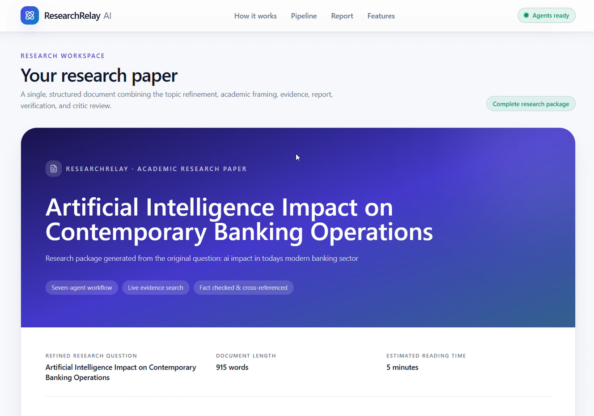
  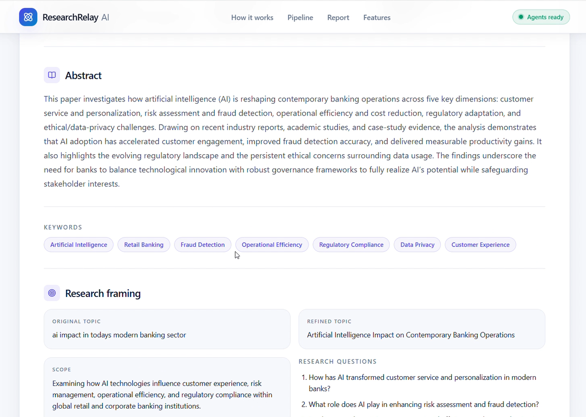
  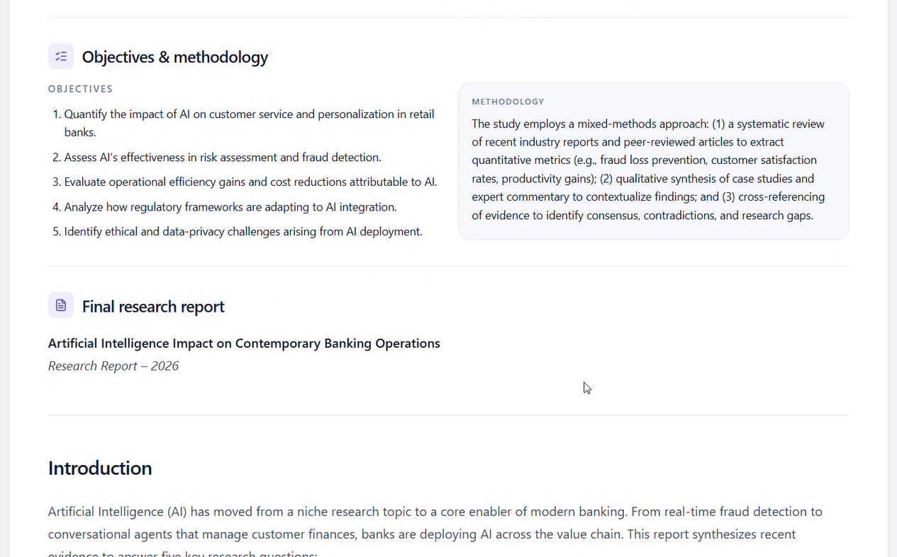
  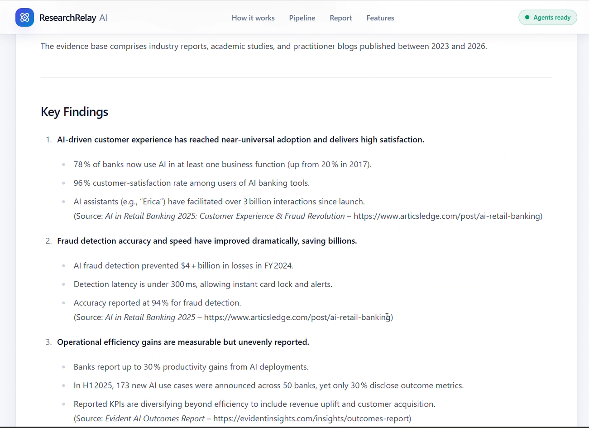
</p>

<p align="center">
  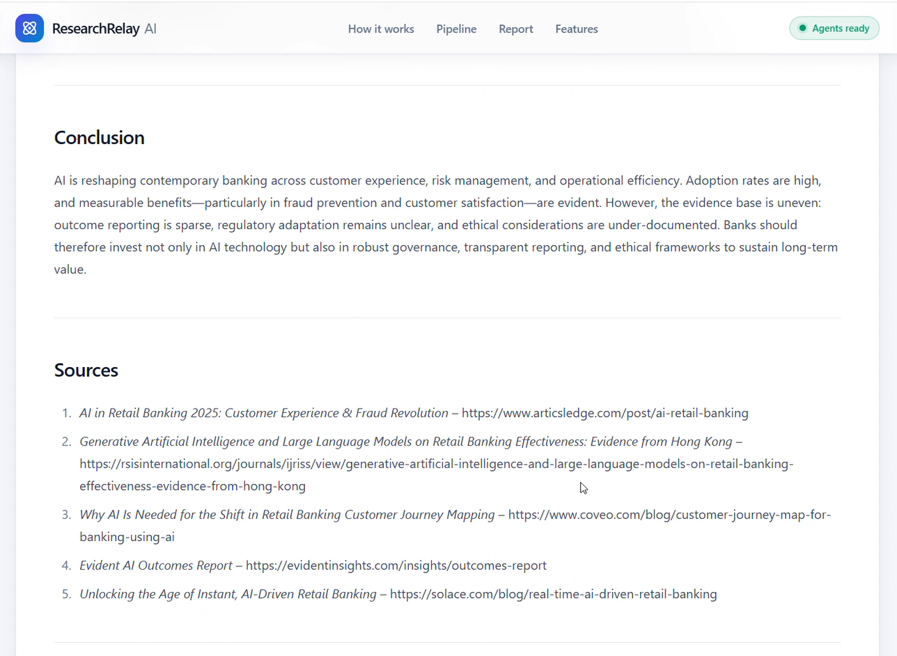
  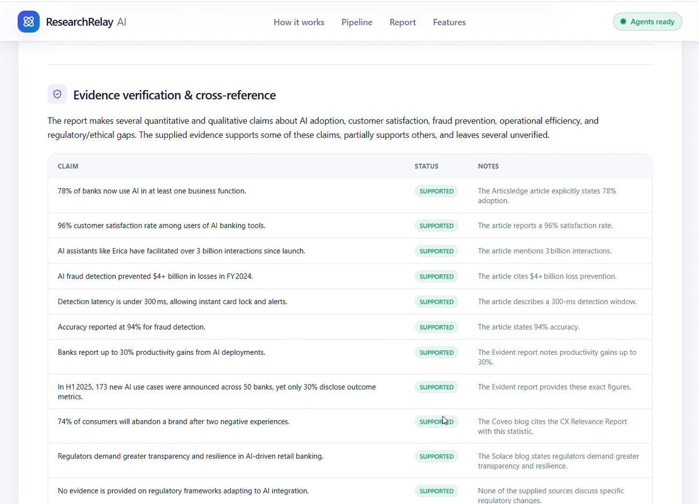
  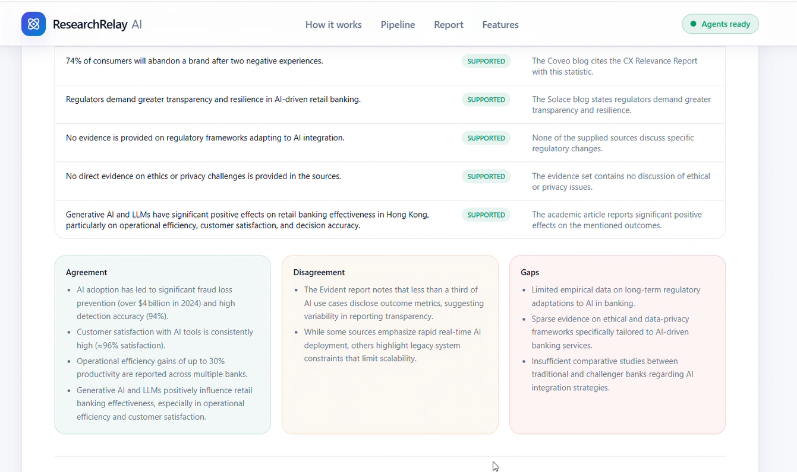
  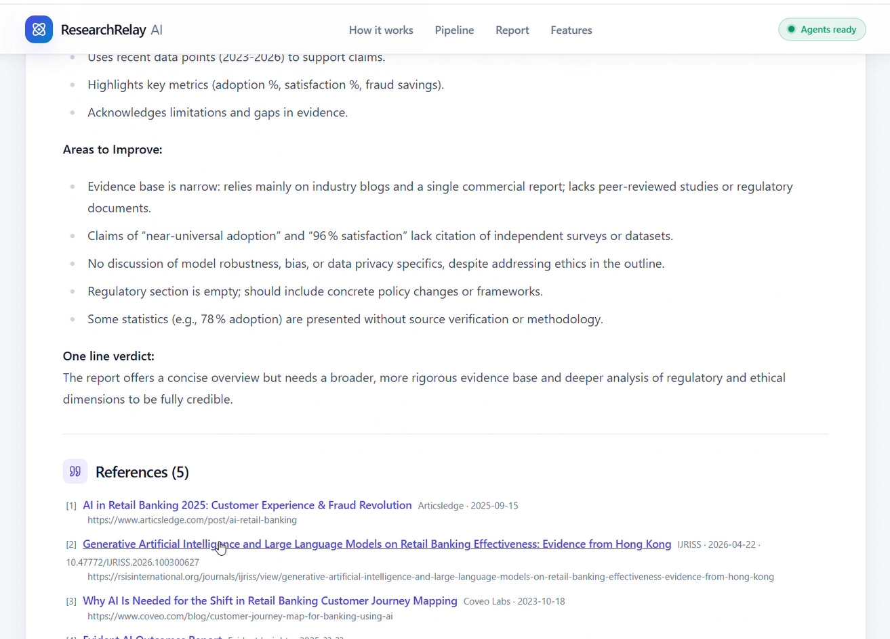
</p>

## Expected Benefits and Real World Impact

<p align="center">
  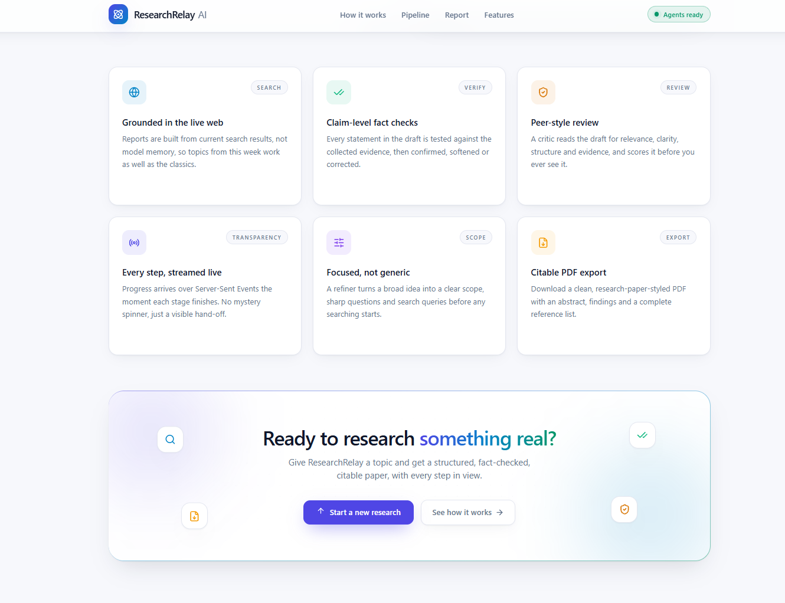
</p>

ResearchRelay AI is intended to make early stage research more organized and accessible.

### For students and postgraduate researchers

It can help structure research ideas, explore related sources, organize findings, and prepare preliminary academic planning materials.

### For academic researchers

It can support initial literature exploration, identify potential research questions, and reveal disagreements that deserve closer investigation.

### For AI and data science practitioners

It can assist with researching algorithms, comparing technical approaches, understanding documented limitations, and organizing technical findings.

### For software developers

It can help investigate frameworks, architectures, APIs, and engineering approaches by gathering relevant documentation and summarizing source material.

### For research teams

It can provide a common workflow for collecting and organizing preliminary evidence before deeper analysis or formal review.

### Potential impact

* Reduced fragmentation across research activities.
* Faster organization of initial findings.
* More visible links between claims and their supporting sources.
* Earlier identification of evidence gaps.
* More systematic preparation of academic materials.
* Better awareness of uncertainty and conflicting information.

These are intended benefits rather than measured outcomes. Their actual magnitude must be established through evaluation with representative research tasks.

## Technology Stack

### Backend and orchestration

* **Python:** Core implementation and research logic.
* **FastAPI:** API endpoints and request handling.
* **LangChain:** Language model integration and agent workflow components.
* **Groq:** Language model inference through the configured provider.
* **Tavily:** Web search and source discovery.
* **BeautifulSoup:** HTML parsing and content extraction.

### Frontend

* **React:** Interactive research interface.
* **JavaScript or TypeScript:** Frontend logic, depending on the current codebase.
* **HTML and CSS:** Layout and responsive presentation.
* **Server Sent Events:** Research progress streaming where implemented.

### Research and output processing

* Structured source metadata and extracted evidence.
* Claim review and cross source comparison.
* The existing PDF generation library and export endpoint.
* Existing evaluation scripts and regression tests, where available.

The exact dependency versions and enabled integrations should be confirmed from the repository's dependency files and implementation.

## Installation and Setup

### Prerequisites

Install Python, Node.js, npm, Git, and the API credentials required by the configured search and language model services.

### Clone the repository

```bash
git clone https://github.com/VinayakR12/ResearchRelayAI_Multi-AgentAI.git
cd ResearchRelayAI_Multi-AgentAI
```

### Configure the backend

Create a Python virtual environment in the project root:

```powershell
python -m venv env
.\env\Scripts\Activate.ps1
```

Install the existing backend dependencies:

```powershell
python -m pip install --upgrade pip
pip install -r requirements.txt
```

Create a `.env` file using the environment variable names expected by the current application.

Example:

```dotenv
GROQ_API_KEY=your_groq_api_key
TAVILY_API_KEY=your_tavily_api_key
```

These variable names must match the existing code. Keep actual credentials private and never commit them to Git.

### Configure the frontend

Open a second terminal:

```powershell
cd frontend
npm install
```

### Start the backend

From the backend project root, activate the environment and run:

```powershell
uvicorn main:app --reload
```

The default local API address is:

`http://127.0.0.1:8000`

Interactive API documentation is normally available at:

`http://127.0.0.1:8000/docs`

### Start the frontend

From the frontend directory:

```powershell
npm run dev
```

Open the local URL printed by the development server. Confirm that the frontend API configuration points to the running backend.

Use the existing project scripts and dependency configuration if their names differ from these examples.

## Limitations and Responsible Use

ResearchRelay AI is designed to assist with research preparation. Its output must not automatically be treated as verified scientific knowledge.

### Source coverage

Search results depend on external search services, indexing, source availability, and query quality. The system may miss relevant publications or fail to access full text.

### Verification reliability

An agent may incorrectly interpret a passage or fail to recognize a contradiction. A supported claim is supported by the retrieved evidence, but that does not necessarily establish that the claim is universally true.

### Reference integrity

A retrieved URL alone does not establish that a publication is peer reviewed or that all bibliographic details are accurate. Important references should be checked against the original publication or a trusted academic index.

### Academic responsibility

Generated titles, abstracts, objectives, and methodology descriptions require human review. Proposed experiments must not be described as completed work, and the use of generated material should follow institutional academic integrity policies.

### External service dependency

Model and search services may experience outages, rate limits, quota restrictions, and latency. Research quality and completion time may therefore vary.

### Evaluation and performance

The number of agents does not itself prove higher accuracy. Improvements should be assessed through repeatable evaluations of source relevance, claim support, citation correctness, completeness, latency, and failure rates.

## Future Improvements

ResearchRelay AI can be extended in several directions.

* **Academic source integration:** Connect to scholarly metadata services such as Crossref, OpenAlex, or Semantic Scholar where appropriate.
* **Reference verification:** Validate DOI identifiers, paper titles, author details, and publication metadata against authoritative records.
* **Improved claim grounding:** Maintain traceable evidence for individual claims throughout generation and revision.
* **More rigorous evaluation:** Expand the evaluation harness with manually reviewed samples and reproducible regression tests.
* **Research export options:** Support additional formats such as Markdown, DOCX, and BibTeX.
* **Citation style selection:** Add configurable IEEE, APA, and other citation styles.
* **Research depth controls:** Let users choose between a quick overview and a more comprehensive investigation.
* **Research history:** Provide optional persistence with clear privacy and retention controls.
* **Reliable orchestration:** Improve bounded retries, cancellation, recovery, and stage level observability.
* **Deployment and testing:** Add automated CI checks, environment validation, and deployment documentation.

## Contributing

Contributions and suggestions are welcome.

1. Fork the repository.
2. Create a feature branch.
3. Implement a focused change.
4. Add or update relevant tests.
5. Run the available backend and frontend checks.
6. Submit a pull request describing the change and its impact.

Please do not commit credentials, confidential research data, or temporary generated files.

## License

An explicit open source license should be added to the repository before the project is distributed for reuse. Until a license is included, do not assume that the code is available for unrestricted redistribution or modification.


---

<p align="center">
  <strong>ResearchRelay AI</strong>
  <br />
  <em>From research ideas to structured, evidence aware insights.</em>
</p>

<p align="center">
  Built to explore how specialized AI agents can support a more organized, traceable, and thoughtful research workflow.
</p>
